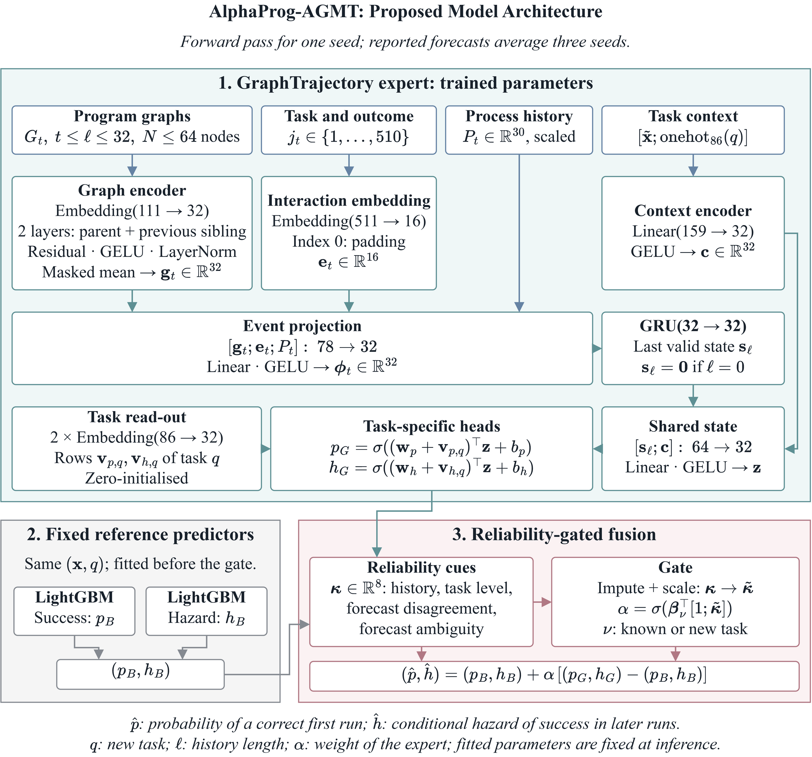
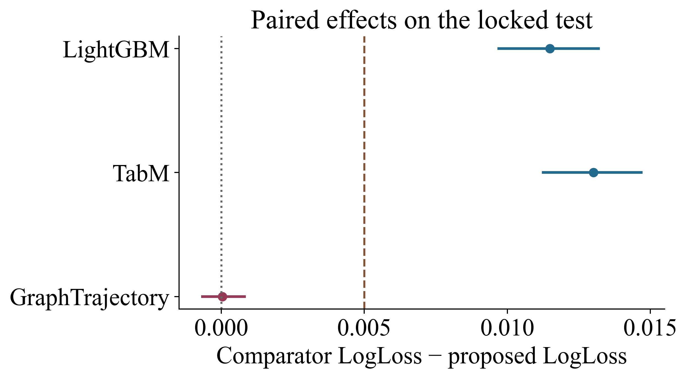
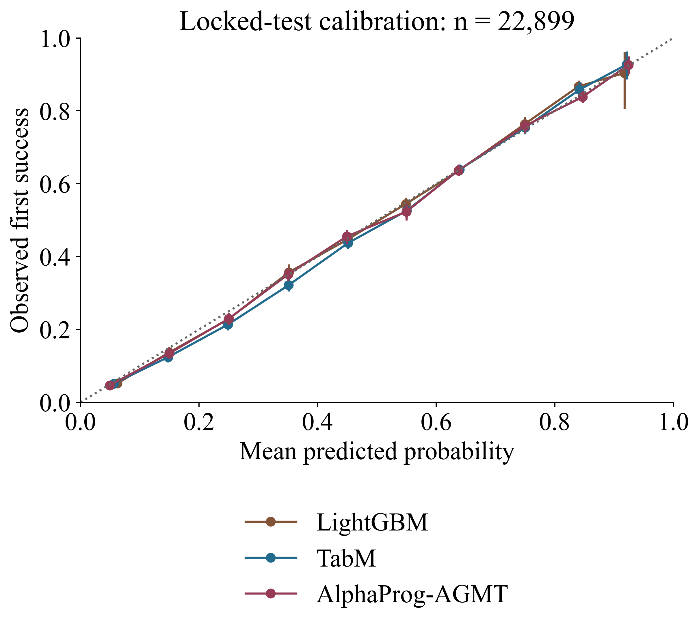
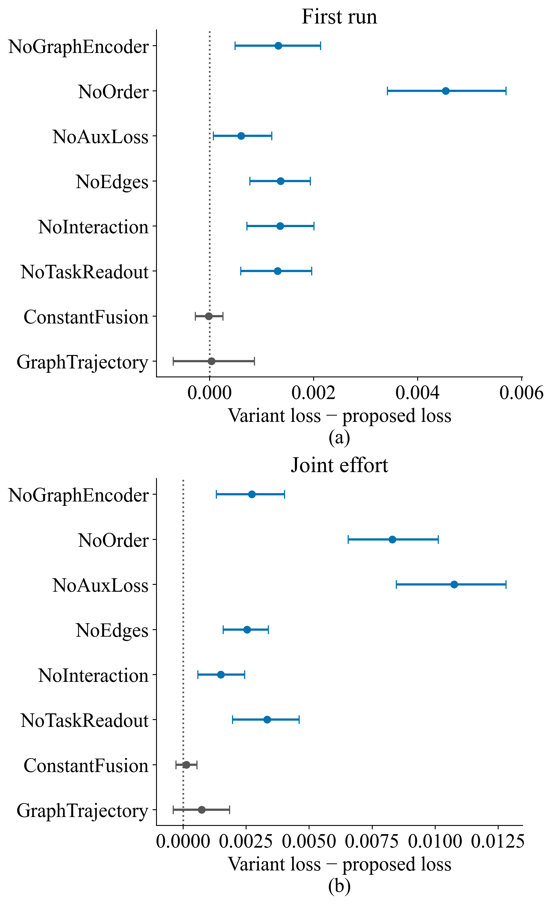
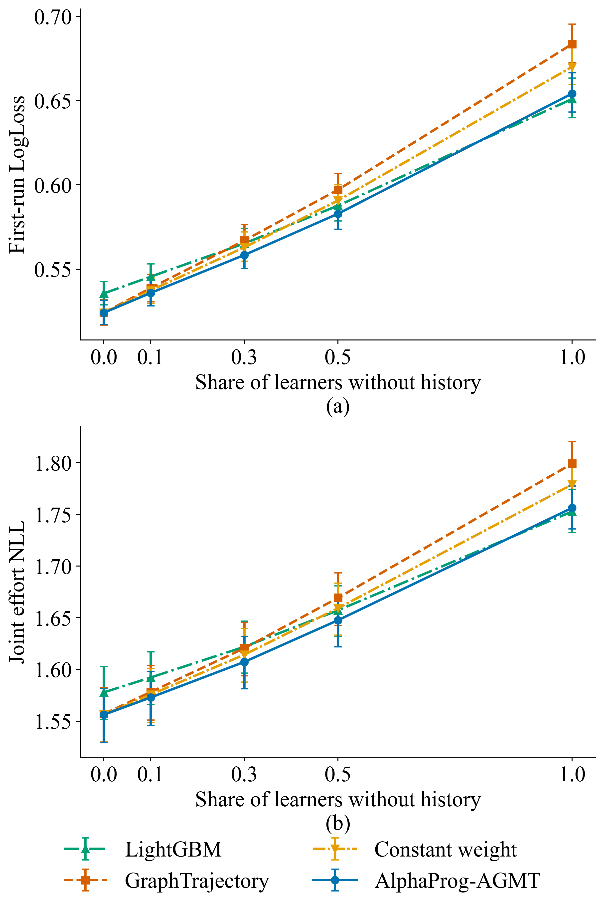

<h1 align="center">AlphaProg-AGMT</h1>

<p align="center">
  <b>A Reliability-Gated Graph-Trajectory Algorithm for Forecasting First-Run Correctness and Censored Effort</b><br>
  <i>An experimental study towards adaptive programming education for Generation Alpha</i>
</p>

<p align="center">
  
  
  
  
  
</p>

This repository contains the executed notebooks, the development and evaluation protocols, the numerical result tables and the figures of the study. Every number reported in the article can be traced to a CSV file in `Tables/` that was written by one of the notebooks.

## Contents

- [Overview](#overview)
- [Method](#method)
- [Results](#results)
- [Repository structure](#repository-structure)
- [Getting started](#getting-started)
- [Reproducibility and research integrity](#reproducibility-and-research-integrity)
- [Scope and limitations](#scope-and-limitations)
- [Data sources and acknowledgements](#data-sources-and-acknowledgements)
- [Citation](#citation)

## Overview

An adaptive programming environment has to decide what a learner should do next before the learner starts a task. AlphaProg-AGMT (Adaptive Graph Multi-task Trajectory) supports this decision with two forecasts issued at the start of a learner's first visit to a block-programming task. Both use only events logged strictly before the visit.

| Target | Definition |
| --- | --- |
| First-run correctness | Probability $\hat{p}$ that the first execution of the learner's program is correct |
| Censored effort | Number of executions until the first success after an incorrect first run, right-censored when the visit ends without success |

**Main findings**

- On 22,899 locked-test queries of 1,762 new learners the algorithm reaches a first-run LogLoss of 0.52416. It improves on LightGBM by 0.01148 (95% CI 0.00966 to 0.01323) and on Deep Knowledge Tracing by 0.01731 (0.01447 to 0.02033).
- The joint effort likelihood improves by 0.02163 (0.01878 to 0.02456) relative to LightGBM with the same hazard model.
- Every component of the expert contributes in three-seed ablations, and none of them is decisive on its own.
- Fusion with the tabular reference does not raise average accuracy over the expert. It halves the spread across seeds and protects the forecast when the learner history is missing.
- The advantage persists in the next school year. It does not extend to tasks without training data, where a descriptor-based tabular model is more accurate.

## Method

<p align="center">
  
</p>
<p align="center"><sub><b>Figure 1.</b> Architecture of AlphaProg-AGMT: the GraphTrajectory expert, the fixed reference predictors and the reliability gate.</sub></p>

**GraphTrajectory expert.** Each previously observed program is parsed into an ordered tree and encoded by two message-passing layers over the parent and previous-sibling relations. The program vector is joined with 30 process descriptors of the same attempt and with a 16-dimensional embedding of the pair formed by the prior task and its observed outcome. A GRU reads the attempts in chronological order. Its last state and the context of the new task form a shared representation, from which two heads with task-specific read-outs predict the first-run probability $p_G$ and a per-run success hazard $h_G$. The expert has 39,698 trainable parameters.

**Training objective.** The expert minimises the binary cross-entropy of the first run plus a censored geometric likelihood of the later executions, with auxiliary weight $\lambda = 1$. The probability of success within $t$ executions follows from the two outputs:

```math
P(r \le t) = 1 - (1 - p)(1 - h)^{t-1}
```

**Reliability gate.** A LightGBM success model and a LightGBM hazard model give the reference pair $(p_B, h_B)$. Eight observable cues (history length, history availability, share of invalid programs, curriculum section, forecast disagreement and forecast ambiguity) determine one weight $\alpha$ that serves both outputs:

```math
(\hat{p}, \hat{h}) = (p_B, h_B) + \alpha \left[ (p_G, h_G) - (p_B, h_B) \right]
```

The gate is fitted on out-of-fold forecasts and has separate coefficients for tasks that are absent from the training data.

**Data preparation.** Histories are reconstructed from the event log. An earlier attempt that is still in progress when the new task starts contributes only its observed prefix. The pipeline is shown in the [data preparation diagram](Docs/DrawIO_PNG_PDF_350dpi/ENG/PNG/AlphaProg_AGMT_Data_and_Architecture_ENG_p1_data_preparation.png).

## Results

### First-run prediction on the locked test

22,899 queries, 1,762 learners. Stochastic models average seeds 17, 42 and 2026. The effect is the comparator LogLoss minus the AlphaProg-AGMT LogLoss; intervals are 95% learner-level bootstrap intervals.

| Model | LogLoss ↓ [95% CI] | AUROC ↑ | AP ↑ | Effect [95% CI] |
| --- | :---: | :---: | :---: | :---: |
| **AlphaProg-AGMT** | **0.52416** [0.51720, 0.53165] | 0.8089 | 0.7457 | reference |
| GraphTrajectory (expert alone) | 0.52420 [0.51693, 0.53179] | 0.8090 | 0.7456 | 0.00004 [−0.00070, 0.00086] |
| LightGBM | 0.53564 [0.52894, 0.54278] | 0.7996 | 0.7350 | 0.01148 [0.00966, 0.01323] |
| XGBoost | 0.53679 [0.53023, 0.54374] | 0.7990 | 0.7347 | 0.01263 [0.01063, 0.01449] |
| TabM | 0.53717 [0.53045, 0.54422] | 0.7986 | 0.7352 | 0.01301 [0.01120, 0.01472] |
| DKT | 0.54148 [0.53420, 0.54951] | 0.7946 | 0.7306 | 0.01731 [0.01447, 0.02033] |
| AKT | 0.54248 [0.53566, 0.54967] | 0.7938 | 0.7269 | 0.01832 [0.01580, 0.02074] |
| UKT | 0.54433 [0.53700, 0.55232] | 0.7922 | 0.7244 | 0.02017 [0.01762, 0.02308] |
| Random Forest | 0.54564 [0.53960, 0.55225] | 0.7937 | 0.7296 | 0.02148 [0.01892, 0.02397] |
| Logistic Regression | 0.55674 [0.54989, 0.56407] | 0.7804 | 0.7067 | 0.03258 [0.02934, 0.03586] |
| ItemMean | 0.59025 [0.58307, 0.59803] | 0.7395 | 0.6343 | 0.06609 [0.06023, 0.07214] |
| GlobalMean | 0.68410 [0.68145, 0.68698] | 0.5000 | 0.4329 | 0.15994 [0.15315, 0.16656] |

All ten differences against models without program structure are significant after Holm correction, and the lower bound of every interval exceeds the practical threshold of 0.005 that was fixed before the test was opened.

<p align="center">
  
  
</p>
<p align="center"><sub><b>Figure 2.</b> Left: paired LogLoss effects with 95% intervals; the dashed line marks the practical threshold. Right: calibration on the locked test.</sub></p>

### Censored effort

| Model | Effort NLL ↓ | Effect [95% CI] |
| --- | :---: | :---: |
| **AlphaProg-AGMT** | **1.55618** | reference |
| GraphTrajectory (expert alone) | 1.55691 | 0.00073 [−0.00039, 0.00184] |
| LightGBM with the hazard model | 1.57781 | 0.02163 [0.01878, 0.02456] |
| TabM with the hazard model | 1.57934 | 0.02316 [0.02034, 0.02584] |

### Additional analyses

| Question | Evidence | Key result [95% CI] |
| --- | --- | --- |
| Which components matter? | Three-seed ablations, Holm correction | Removing the attempt order costs 0.00454 [0.00341, 0.00569]; tree edges, interaction embedding, program encoder and task read-out cost 0.00130 to 0.00136 each; the auxiliary loss is worth 0.01075 [0.00845, 0.01280] in Effort NLL |
| What does the gate add? | Removal of all history for 10% to 100% of learners | With all history removed the fused forecast is better than the expert by 0.02936 [0.02720, 0.03168] and stays within 0.00323 of LightGBM |
| Is the forecast stable? | Seed-level spread and calibration | Seed SD 0.00049 against 0.00111 for the expert; ECE 0.00924 against 0.00969 |
| Does it hold in a later period? | Training before 1 September 2019, evaluation after | 0.00970 [0.00696, 0.01250] against LightGBM |
| Does it hold on unseen tasks? | Three task folds, task identifier withheld | Better than the expert by 0.00672 [0.00473, 0.00887] and than LightGBM by 0.02025 [0.01762, 0.02282]; worse than TabM by 0.01431 [0.01201, 0.01658] |
| Is the gain explained by richer inputs? | LightGBM with per-attempt sequences; Code-DKT-type model | 0.00832 [0.00666, 0.01007] and 0.01295 [0.01046, 0.01573] remain |
| Were the neural comparators undertrained? | 16 epochs with epoch selection on validation | TabM stays behind by 0.00932 [0.00743, 0.01121] |
| Does the constant hazard drive the conclusions? | Run-dependent hazard, stratified IPCW | Effort advantage over LightGBM 0.01965 [0.01706, 0.02226] under the run-dependent hazard |
| What is the practical value? | Net benefit of support rules; detection of long visits | Net benefit higher than LightGBM by 0.0047 to 0.0111 per query; AUROC 0.863 against 0.854 for visits longer than five runs |
| What does it cost? | One computer, four CPU threads | Fit 87.8 s against 1.8 s for LightGBM; inference 24.0 ms per 1,000 queries |

<p align="center">
  
  &nbsp;&nbsp;
  
</p>
<p align="center"><sub><b>Figure 3.</b> Left: paired ablation effects for the first run (a) and the joint effort (b). Right: loss when all prior history is removed for a share of learners.</sub></p>

The complete outputs are in `Tables/` and `Figures/`; the notebook that writes a file is given by the two-digit prefix of its name.

## Repository structure

```text
AlphaProg-AGMT/
├── Notebooks/                 Notebooks 01 to 07 with executed cells and saved outputs
├── Protocol/                  Split protocols, feature contract, development protocol,
│                              frozen configuration, test boundary, execution ledger
├── Tables/                    Numerical result tables (CSV) written by the notebooks
├── Figures/                   Figures written by the notebooks (PNG and PDF, 350 dpi)
├── Docs/
│   ├── *.drawio               Diagrams of data preparation and architecture (ENG, RUS, KAZ)
│   ├── DrawIO_PNG_PDF_350dpi/ Exported diagrams
│   └── Method_Sources/        AKT and UKT source files of pyKT with the MIT licence
├── Logs/                      Training log of the additional analyses
└── requirements-tested.txt    Package versions of the reported run
```

| Notebook | Stage | Main outputs |
| --- | --- | --- |
| `01_Data_and_Research_Design` | Data, observation quality, population, unit of prediction, splits | Cohorts, split protocols, source manifest |
| `02_EDA_and_Leakage_Safe_Features` | Exploratory analysis, dependence, shift, features built strictly before the prediction time | Features, sequences, program graphs, feature contract |
| `03_Baseline_Models` | Frequency controls, tabular models, school branch | Tuned baselines and their forecasts |
| `04_Contemporary_Models` | DKT, AKT, UKT and TabM under a common protocol | Tuned neural comparators |
| `05_Proposed_Model_and_Ablations` | GraphTrajectory, joint loss, staged selection on validation with a backward check, gate, ablations | Frozen configuration |
| `06_Model_Analysis` | Locked test, statistical comparisons, calibration, stability, errors, cost | Test evaluation of the frozen configuration |
| `07_Final_Publication_Results` | Publication tables and figures, additional analyses | Tables and figures of the article |

## Getting started

### Requirements

The reported run used Windows 11, an NVIDIA GeForce RTX 5070 Laptop GPU, Python 3.13.17, PyTorch 2.11.0 built for CUDA 12.8 and the package versions listed in `requirements-tested.txt`. The plotting code checks that the Times New Roman font is installed.

```bash
git clone https://github.com/Guldek1987/AlphaProg-AGMT.git
cd AlphaProg-AGMT
python -m venv .venv
.venv\Scripts\activate
pip install -r requirements-tested.txt
python -m ipykernel install --user --name alpha-cuda --display-name "Python (alpha-cuda)"
```

Install the CUDA build of PyTorch 2.11.0 that matches your driver. On Windows start the kernel with the environment variable `PYTHONUTF8=1`.

### Data

The data are not redistributed in this repository. Both sources are public; `Protocol/source_manifest.json` lists the download address, the size and the SHA-256 checksum of every file.

| Source | Files | Location in the working tree |
| --- | --- | --- |
| RoboMission, archive `robomission-2019-12-10` | `events.csv`, `attempts.csv`, `problems.csv` | `Data/Raw/robomission/robomission-2019-12-10.zip`, unpacked to `Data/Raw/robomission/robomission-2019-12-10/` |
| Zenodo record 7489244 | `student_test_janjune_2021.csv`, `student_surveytest_nov_2021.csv`, `student_survey_may_2022.csv` | `Data/Raw/zenodo_7489244/` |

Notebooks 01 and 02 write the processed cohorts, features, sequences and program graphs to `Data/Processed/`. Notebooks 03 to 07 write forecasts and trained models to `Results/`. Both folders are created locally and are not part of the repository because of their size.

### Running the notebooks

Start JupyterLab from the repository root and execute the notebooks in order, each from a fresh kernel and from the first cell to the last. A notebook can also be executed without the interface:

```bash
cd Notebooks
jupyter nbconvert --to notebook --execute --inplace --ExecutePreprocessor.kernel_name=alpha-cuda --ExecutePreprocessor.timeout=-1 05_Proposed_Model_and_Ablations.ipynb
```

Notebooks 05 to 07 take about two and a half hours on the stated device. `Protocol/execution_ledger.json` records how each notebook of the reported run was executed.

## Reproducibility and research integrity

- **Prediction-time boundary.** Features use only events observed strictly before the start of the current visit. Twelve probe queries in notebook 02, including cases with an earlier attempt still in progress, confirm that removing all later events leaves the features unchanged.
- **Learner-disjoint evaluation.** Learners are assigned to the training, validation and test partitions by a hash of the learner identifier. Transformations and vocabularies are fitted inside the corresponding training fold.
- **Recorded development procedure.** The configuration was selected by the procedure of `Protocol/model_development_protocol.json`. Every stage was written down before its candidates were trained, and every choice was made on validation data: training regime and auxiliary weight (stage A), representation of the target task (B), capacity (C), interaction embedding and task read-out (D), gate coefficients for new tasks (E). A backward check (F) removes each adopted module in turn and keeps it only if the removal raises the criterion by at least 0.0002; it removed the target-conditioned attention module.
- **Frozen sources.** The code cells of notebooks 01 to 05 are protected by SHA-256 checksums (`Protocol/frozen_training_sources.json`), and notebook 07 verifies the cells of notebook 06 that it reuses. A change of these cells after the test evaluation stops the execution.
- **Status of the test split.** The test was evaluated once for the selected configuration. The test split had been evaluated before this configuration was selected, so the test result is not an independent confirmation and may be optimistic.
- **Statistics.** Confidence intervals come from a learner-cluster bootstrap with 1,000 replicates, tests from paired learner-level sign-flip randomisation with 2,000 replicates, and Holm's correction is applied within each declared family of comparisons.
- **Determinism.** Training of the graph expert uses deterministic CUDA kernels and reproduces the forecasts exactly on the same device. Bitwise identity across devices is not guaranteed.

## Scope and limitations

- The algorithm in its present form is intended for tasks that already have training data. The task-specific parameters are untrained for a newly added task, and a descriptor-based model is preferable there until attempts have been collected.
- The data come from one platform, one task catalogue and the years 2017 to 2019. No compatible open data set was available for external validation; the next-school-year and unseen-task schemes are internal checks on the same learners.
- RoboMission does not record ages. Its cohort is a proxy for block-based practice and not a verified sample of Generation Alpha. The school branch (grades 3 and 4, ages 7 to 9 in 2021) belongs to Generation Alpha by birth year, but it addresses a different task and is not an external validation of the programming model.
- Censoring depends on observed covariates, and the hazard is assumed constant. Comparative conclusions on effort hold under a run-dependent hazard; absolute horizon probabilities depend on the hazard specification.
- The analysis is retrospective. It does not establish a pedagogical effect of adaptive support.

## Data sources and acknowledgements

- **RoboMission.** Adaptive Learning Group, Masaryk University. Web application and educational programming interaction data, archive `robomission-2019-12-10`.
- **School data.** El-Hamamsy, L., Bruno, B., Dehler Zufferey, J., Mondada, F. Dataset for the Evaluation of Student-Level Outcomes of a Primary School Computer Science Curricular Reform. Zenodo, 2023. DOI: [10.5281/zenodo.7489244](https://doi.org/10.5281/zenodo.7489244). Licence: CC BY 4.0.
- **pyKT.** The AKT and UKT model files in `Docs/Method_Sources/` come from the pyKT library and are distributed under its MIT licence (`LICENSE_pykt`).

The data remain under the terms of their original providers.

## Citation

The article that describes this work is under review. Until it is published, please cite the repository:

```bibtex
@misc{alphaprog_agmt_2026,
  title        = {AlphaProg-AGMT: A Reliability-Gated Graph-Trajectory Algorithm for
                  Forecasting First-Run Correctness and Censored Effort},
  author       = {Guldek1987},
  year         = {2026},
  howpublished = {\url{https://github.com/Guldek1987/AlphaProg-AGMT}},
  note         = {Notebooks, protocols, result tables and figures}
}
```

Questions and problem reports are welcome in the [issue tracker](https://github.com/Guldek1987/AlphaProg-AGMT/issues).
